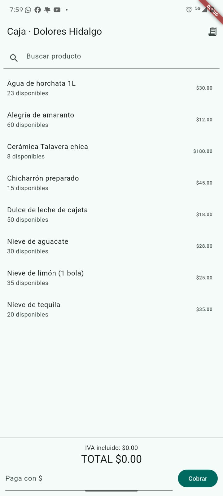
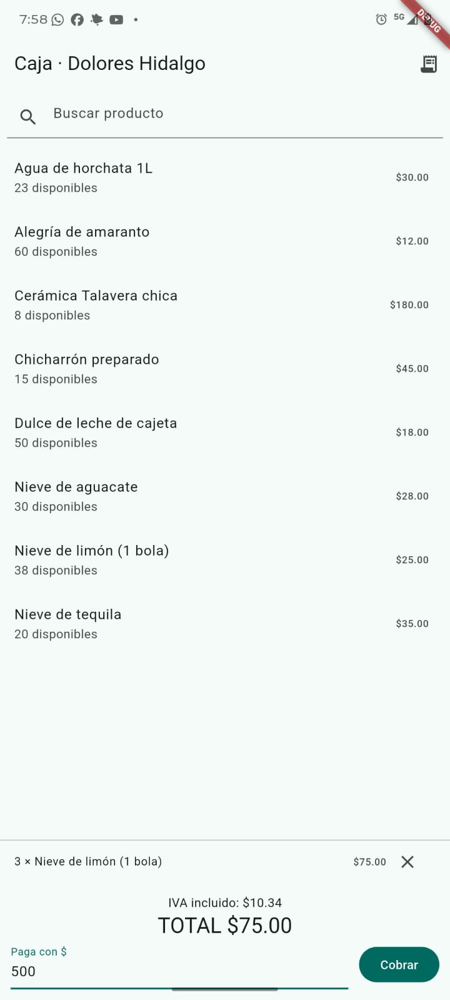
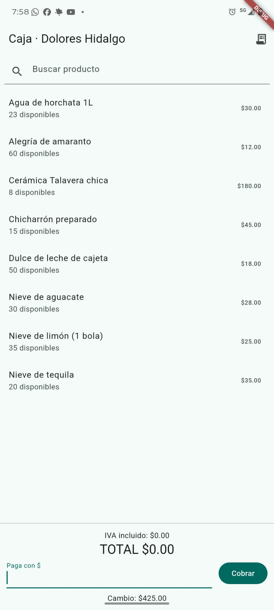
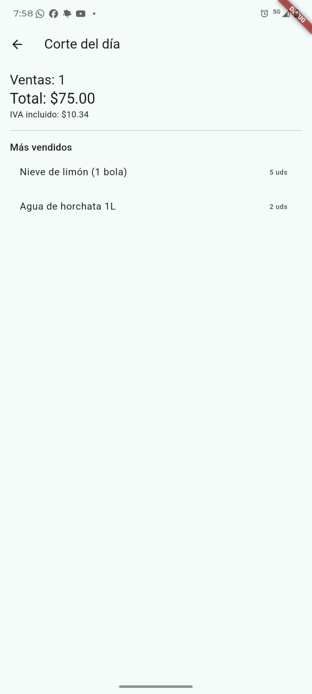

# punto_venta_dolores

App de punto de venta hecha con **Flutter** y **SQLite local** (funciona sin internet), desarrollada con **TDD**. Calcula totales, IVA y cambio sin errores, descuenta el inventario automáticamente y hace el corte del día.

Materia: Desarrollo de Aplicaciones Móviles

## Capturas
Instalación de dependencias  
Ronda 1 - Prueba1_Roja 
Ronda 1 - Prueba1_Verde 
Ronda 1 - Prueba2_Roja 
Ronda 1 - Prueba2_Verde 
Ronda 2 - El Producto 
Ronda 3 - 3.1 Sumar Cantidades 
Ronda 3 - 3.2_No Vender Lo Que No Hay 
Ronda 3 - 3.3_IVA Incluido Con Enteros 
Ronda 3 - 3.4_Cambio, Pago corto y Carrito vacio 
Ronda 3 - 3.5_Las Clases de Venta 
Ronda 4 - Base de Datos Local (SQLite) 
Ronda 5 - Cobrar Transaccion- 5.1 Cobrar Descuento Inventario 
Ronda 5 - Cobrar Transaccion- 5.2 Demostración de la transacción y 5.3 Corte del dia 
Ronda 6 - ViewModel y Pantalla 

PANTALLAS: 
Pantalla de Caja  
Pantalla de Carrito  
Pantalla de Cobros  
Pantalla de Corte del Dia 

## Funciones
- Catálogo de productos con búsqueda
- Carrito con IVA incluido (16%) desglosado
- Cobro con cálculo de cambio
- Descuento automático de inventario con transacción (todo o nada)
- Corte del día: ventas, total, IVA y productos más vendidos

## Arquitectura
```
lib/
  dominio/        reglas del negocio (Dart puro): dinero, producto, carrito, venta
  datos/          SQLite: base de datos y repositorios
  presentacion/   ViewModel y pantallas
  main.dart       aquí se conecta todo
test/
  dominio_test.dart
  datos_test.dart
```

## Decisiones técnicas

- **El dinero se guarda en centavos enteros**, nunca en `double`, para evitar errores de redondeo.
- **Cobrar usa una transacción**: si algo falla, no se guarda la venta ni se descuenta inventario.
- **Pruebas de datos con SQLite en memoria**, sin emulador.

## Cómo ejecutarlo

```
flutter pub get
flutter test
flutter run
```

Se necesita un teléfono Android con depuración USB o un emulador. En web no funciona porque `sqflite` no la soporta.

## Pruebas
18 pruebas automáticas (dominio y datos), escritas primero en rojo con TDD.
