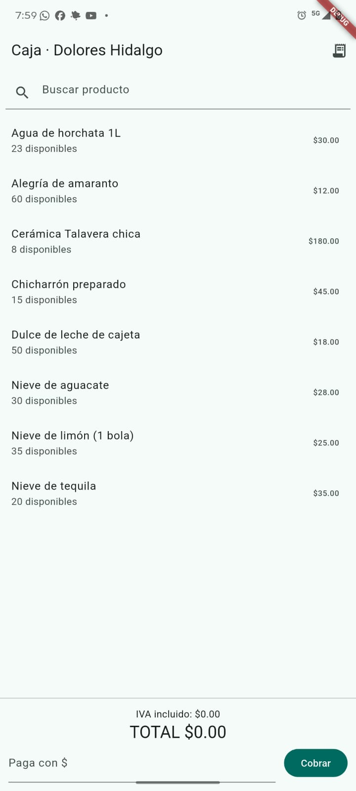
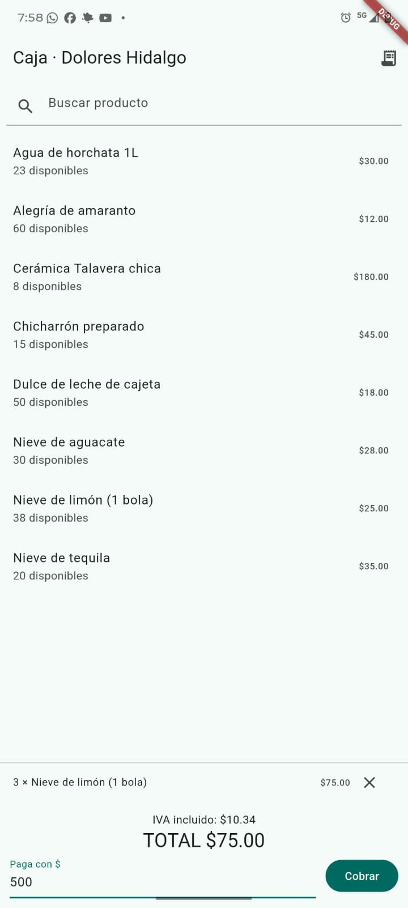
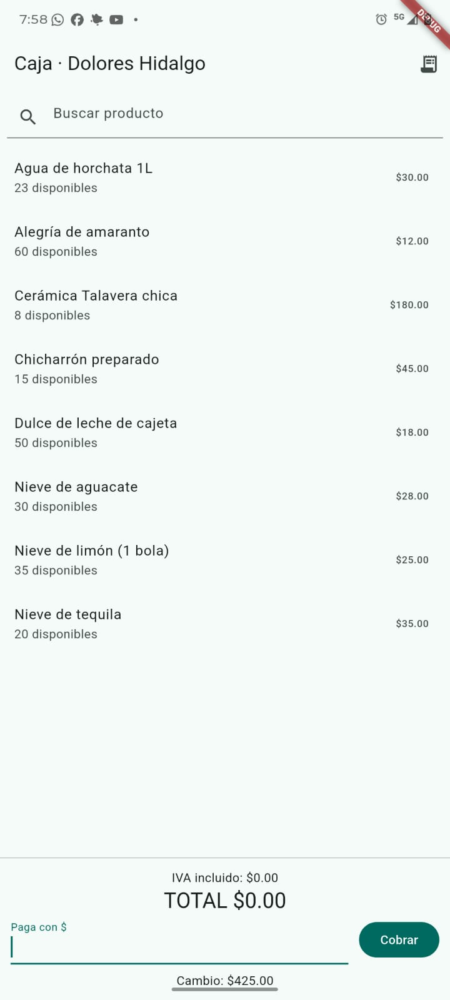
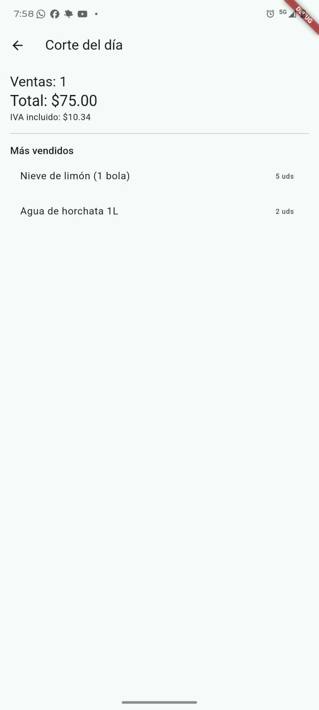

# punto_venta_dolores

App de punto de venta hecha con **Flutter** y **SQLite local** (funciona sin internet), desarrollada con **TDD**. Calcula totales, IVA y cambio sin errores, descuenta el inventario automáticamente y hace el corte del día.

Materia: Desarrollo Móvil

## Capturas

   

## Funciones
- Catálogo de productos con búsqueda
- Carrito con IVA incluido (16%) desglosado
- Cobro con cálculo de cambio
- Descuento automático de inventario con transacción (todo o nada)
- Corte del día: ventas, total, IVA y productos más vendidos

## Arquitectura
```
lib/
  dominio/        reglas del negocio (Dart puro): dinero, producto, carrito, venta
  datos/          SQLite: base de datos y repositorios
  presentacion/   ViewModel y pantallas
  main.dart       aquí se conecta todo
test/
  dominio_test.dart
  datos_test.dart
```

## Decisiones técnicas

- **El dinero se guarda en centavos enteros**, nunca en `double`, para evitar errores de redondeo.
- **Cobrar usa una transacción**: si algo falla, no se guarda la venta ni se descuenta inventario.
- **Pruebas de datos con SQLite en memoria**, sin emulador.

## Cómo ejecutarlo

```
flutter pub get
flutter test
flutter run
```

Se necesita un teléfono Android con depuración USB o un emulador. En web no funciona porque `sqflite` no la soporta.

## Pruebas
18 pruebas automáticas (dominio y datos), escritas primero en rojo con TDD.
